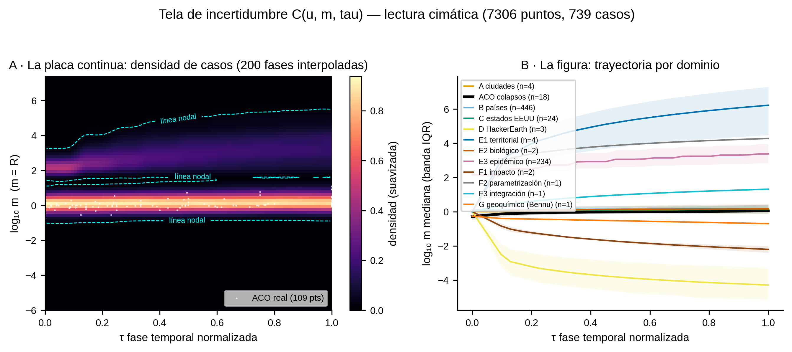
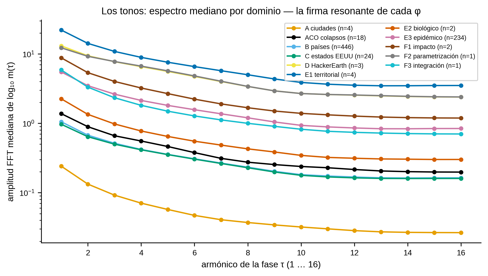

# Shadow Node Theory · v2.7.1

[](CHANGELOG.md)
[](papers/marco_teorico.md)
[](https://github.com/Inzainos/The-shadow-Node-Theory/actions/workflows/python-package-conda.yml)

## 1. ¿Qué es la Shadow Node Theory?

La **Shadow Node Theory (SNT)** describe cómo cambia, a lo largo del tiempo,
la relación entre un **hub** (el centro dominante de una red) y un **nodo**
(un componente periférico relacionado con él). La medida básica es la razón
`R(t) = métrica_del_hub / métrica_del_nodo`; se estudia cómo evoluciona y se
resume con una ley de potencia `R(t) = a·t^b`.

El exponente `b` describe la dirección y la forma de esa relación dentro de la
ventana observada:

| `b` | Lectura descriptiva |
|---|---|
| `b < 0` | El nodo converge: gana terreno relativo frente al hub. |
| `b ≈ 0` | La razón permanece aproximadamente equilibrada. |
| `0 < b < 1` | La razón crece de forma sublineal en el ajuste de potencia. |
| `b ≥ 1` | Pendiente estimada alta; **no basta para declarar un régimen superlineal**. |

SNT es un marco para comparar trayectorias con definiciones, fuentes y límites
de inferencia explícitos; no afirma que todos los sistemas obedezcan una ley
universal ni que el ajuste por sí solo demuestre un mecanismo causal.

## 2. ACO-A: describir lo que ocurre después del colapso

La **Arquitectura de Colapso Orbital Acoplada (ACO-A)** complementa la
satelización con una pregunta distinta: tras la extinción funcional de un hub,
¿un sucesor identificable absorbe su masa o actividad y cómo evoluciona esa
absorción? Se representa como
`A(τ) = c·τ^Δ`, donde `A = masa_del_absorbente / pico_del_hub` y `τ` es el
tiempo desde la extinción funcional. `Δ` resume la forma de la absorción; no es
el mismo reloj ni la misma razón que `b`.

No toda desaparición cuenta como ACO: el caso requiere extinción funcional y
un sucesor identificable que capture la masa o actividad. La relación entre
`b` y `Δ` se evalúa empíricamente; la evidencia de ortogonalidad está
respaldada bajo un criterio de equivalencia en una cohorte de 242 pares cripto,
no establecida como ley universal para todos los dominios.

## 3. Qué significa —y qué no— “superlineal”

En versiones anteriores, `b ≥ 1` se describía como “superlineal”. La
calibración RC1 mostró que esa etiqueta no identifica por sí sola un mecanismo
o régimen: una exponencial verdadera, al ajustarse como potencia, también
produce `b ≥ 1` con frecuencia. Además, la compuerta pre-registrada de error
AIC (máximo 20%) no se superó en ninguno de los dominios calibrados: E3 80,3%,
B 96,8%, ACO 48,9%, C 22,6% y E2_01 94,0%.

Por eso, en este README `b ≥ 1` se informa como **banda descriptiva no
clasificada**, no como prueba de aceleración ni como régimen físico confirmado.
La explicación completa y la calibración están en
[Resultados RC1](reconstruction_real/audits/RESULTADOS_RC1_SUPERLINEAL_2026-10-02.md)
y [RC1 en dominios restantes](reconstruction_real/audits/RESULTADOS_RC1_DOMINIOS_RESTANTES_2026-10-17.md).

## 4. La tela de incertidumbre: poner las trayectorias en contexto

Después de definir las trayectorias SNT y ACO-A, la **tela de incertidumbre**
las organiza como proyecciones en `𝒞(u, m, τ)`. En la implementación, `m=R`,
`τ` es la fase temporal normalizada entre 0 y 1, y cada observación declara su
marco de medición `θ = (B, V, ρ, W, λ)`. El eje `u` aún no tiene una definición
operativa admitida y se conserva como `NULL`; la fricción `φ` es postulada por
dominio, no medida como campo continuo.

> **Alcance de v2.7.1:** el corpus consolidado SNT conserva **721 casos**. La
> tela es una capa analítica separada de **740 trayectorias y 51.210 puntos**:
> 699 series reales reconstruidas desde fuentes versionadas y 41 sombras del
> modelo explícitamente identificadas. No son 740 casos nuevos del corpus ni
> 740 réplicas independientes.

<p align="center">
  
  
</p>

### Qué integra y qué se midió

| Capa | Qué integra | Resultado auditado |
|---|---|---|
| **Series reales** | E3 (234), B (446), ACO (18) y G (1); 50.813 puntos desde datos versionados | B reproduce 446/446; E3, 233/234 pendientes dentro de ±0,01 en `b`; ACO, 18/18. |
| **Cubo v2** | Series reales donde existen y 41 sombras donde faltan | 740 trayectorias / 51.210 puntos; las sombras no se presentan como observaciones reales. |
| **Lectura cimática** | Placa continua, figuras por dominio, espectros, huellas y prueba leave-one-out | LOO: 50,7% por dominio y 66,2% por tono `φ`; resultado exploratorio, no clasificador calibrado. |
| **Dirección → destino** | Asociación de la pendiente en el primer 25% con el régimen al cierre | Spearman: E3 `+0,823`, B `+0,224`, ACO `+0,413` (`n=18`, `p=0,089`, no concluyente). Es descriptiva, no causal. |

La matriz agrupada está condicionada por la composición: E3 domina el tercil
rápido y B el lento. La figura **no** identifica de forma fiable la etiqueta
del dominio. En los 18 casos ACO, la mediana de `|log₁₀ m|` pasa de 0,292 a
0,071 —las trayectorias terminan más cerca de `m=1` en esta muestra—, pero el
tamaño muestral no permite concluir que exista un atractor universal.

### Casos de uso: qué pregunta responde la tela

La tela no es solo una imagen: permite **seguir una razón en una trayectoria**,
separar series observadas de sombras y comparar el inicio con el final de una
ventana. Ejemplos de los datos ya integrados:

| Caso | Pregunta práctica | Qué muestra la tela | Qué no permite concluir |
|---|---|---|---|
| **Países (B): PIB per cápita hub/nodo** | ¿Se reconstruyó la trayectoria relativa a través del tiempo? | Las 446 series reales reproducen `b` publicado usando MPD2020; se puede inspeccionar `R` a lo largo de la ventana. | La reproducción no prueba acoplamiento hub-nodo ni significancia: la autocorrelación es severa y la inferencia puntual de B sigue indecidible. |
| **Epidemias (E3): crecimiento de casos COVID-19** | ¿La dirección temprana está asociada con el estado al cierre de la ventana? | 233/234 pendientes reproducen dentro de ±0,01; en esta selección de trayectorias de crecimiento, la asociación es `ρ=+0,823`. | No es una alerta anticipada validada ni una regla general para epidemias; la cohorte se seleccionó por fase de crecimiento. |
| **Colapsos ACO-A** | ¿La trayectoria se acerca o se aleja de `m≈1`? | En 18 casos, `|log₁₀ m|` mediano baja de 0,292 a 0,071. | No demuestra un atractor universal ni predice cuándo ocurrirá un colapso (`ρ=+0,413`, `p=0,089`). |
| **Bennu (G): proxy geoquímico** | ¿Puede inspeccionarse una trayectoria real de otro dominio? | Hay un caso y tres puntos versionados: una visualización y un punto de partida para identificar datos faltantes. | Un caso no estima distribuciones ni permite generalizar a cuerpos celestes. |

**Cómo leer la placa:** el eje horizontal `τ` recorre cada ventana desde el
inicio (0) hasta el final (1); el vertical `log₁₀ m` representa `m=R` en escala
logarítmica. La densidad muestra dónde pasan las trayectorias; la figura
resume la mediana por dominio y su banda IQR. Una curva que termina más cerca
de cero acaba más cerca de `m=1`. Una forma parecida no convierte una sombra
en dato observado.

**Aplicación externa:** [Casos de uso de SNT](CASOS_DE_USO.md) documenta,
entre otras pruebas independientes, ACO-A en 450 paquetes npm
(`ρ(b, Δ)=+0,114`, IC95 `[+0,016, +0,209]`). npm aún **no forma parte de la
tela integrada**: incorporarlo requeriría construir y auditar su serie `R(t)`,
declarar `θ` y repetir el análisis.

**Informes:** [tela integrada](reconstruction_real/audits/TELA_V2_INTEGRADA_2026-10-21.md) ·
[capa exógena](reconstruction_real/audits/TELA_EXOGENA_2026-10-21.md) ·
[resultados cimáticos](reconstruction_real/audits/TELA_CIMATICA_2026-10-21.md) ·
[implementación del cubo](reconstruction_real/audits/TELA_DE_INCERTIDUMBRE_2026-10-21.md).

**Figuras:** [placa continua (PNG)](figures/fig_tela_cimatica_chladni.png) ·
[placa vectorial (SVG)](figures/fig_tela_cimatica_chladni.svg) ·
[tonos (PNG)](figures/fig_tela_cimatica_tonos.png) ·
[tonos vectoriales (SVG)](figures/fig_tela_cimatica_tonos.svg).

La numeración de versiones es independiente: v2.7.1 es el paquete del
repositorio; el marco teórico activo sigue en v34 y el corpus SNT en 721 casos.
La tela añade una capa de trayectorias y análisis, no cambia el tamaño del
corpus consolidado.

El estado que sigue prioriza resultados empíricos auditados. El corpus de
721 casos **no equivale a 721 réplicas independientes**, y la reproducibilidad
varía entre dominios.

## Hallazgos empíricos

| Área | Resultado observado | Alcance y límite | Informe |
|---|---|---|---|
| **Dominio B — satelización histórica** | Las 446 pendientes se reproducen byte a byte con MPD2020. El 99.8% de las series presenta autocorrelación severa; 290/446 no son estimables bajo el criterio de tamaño efectivo. | En una recalibración de 200,000 simulaciones, ninguno de los 12 métodos queda dentro de la banda de falsos positivos predefinida `[2.5%, 7.5%]`. El valor puntual es **indecidible**; no se debe citar la proporción nominal como conclusión inferencial. | [Recalibración de B](reconstruction_real/audits/RESULTADOS_RECALIBRACION_DOMINIO_B_2026-10-03.md) · [Auditoría v32](reconstruction_real/audits/AUDITORIA_INTEGRAL_v32.md) |
| **Dominio B — hub comercial** | Con un hub definido por comercio bilateral, `ρ(b, brecha) = −0.153` (`p=0.125`); la comparación hub–control no detecta diferencia (`p=0.78`). | La reconstrucción con hub emergente no rescata evidencia de acoplamiento SNT por encima del nulo calibrado. | [Reconstrucción de B con comercio](reconstruction_real/audits/RECONSTRUCCION_DOMINIO_B_HUB_COMERCIO.md) |
| **RC1 — exponentes `b ≥ 1`** | El error de selección AIC es 80.3% en E3, 96.8% en B, 48.9% en ACO, 22.6% en C y 94.0% en el único caso E2_01 calibrable. | Ningún dominio calibrado supera la compuerta pre-registrada del 20%; por tanto, la etiqueta de régimen superlineal no se interpreta con AIC. Una exponencial verdadera produce `b ≥ 1` con frecuencia en E3/B/ACO, pero solo 0.7% en C: el artefacto no es universal y la calibración debe ser específica por dominio. | [RC1 en dominios restantes](reconstruction_real/audits/RESULTADOS_RC1_DOMINIOS_RESTANTES_2026-10-17.md) · [RC1 superlineal](reconstruction_real/audits/RESULTADOS_RC1_SUPERLINEAL_2026-10-02.md) |
| **Reproducibilidad por dominio** | C reproduce 23/23 casos con una receta preespecificada; A reproduce 1/4 (coincidencia espuria por usar una ventana incompatible); E2 reproduce 1/2. | D depende de datos propietarios; E1 no se reproduce; F1–F3 no contienen trayectorias temporales `R(t)` equivalentes. Un caso o dominio no reproducible no se presenta como replicado. | [Matriz de resultados RC1](reconstruction_real/audits/RESULTADOS_RC1_DOMINIOS_RESTANTES_2026-10-17.md) |
| **HackerEarth — evaluación temporal** | Con etiqueta temporal de 30 días y validación cruzada de cinco pliegues, el AUC es **0.836 ± 0.038** (`n=2,058`); en usuarios con antigüedad ≥7 días, **0.893 ± 0.041** (`n=137`). | Una ventana y un corte; hay censura a la derecha y la cohorte tiene alta dormancia. Las métricas antiguas basadas en etiquetas definidas por engagement eran circulares y no son evidencia predictiva. El dataset crudo propietario no se redistribuye. | [Auditoría HackerEarth](reconstruction_real/audits/REVISION_REPORTE_HACKEREARTH_2026-10-18.md) · [Números reales](data/hackerearth_zerve/NUMEROS_REALES_2026-10-18.md) |
| **N-cuerpos — rango-tamaño** | Para las 32 entidades mexicanas, la lognormal mejora el AIC frente a la potencia en 65.04 puntos. La réplica internacional favorece la lognormal en 5/6 niveles y la potencia en los municipios brasileños. | La prueba de Clauset no alcanza la tasa de error requerida en ningún nivel: incluso en Brasil (`n=5,570`) deja pasar una ley de potencia en 42.6% de muestras lognormales. No es evidencia general de apego preferencial. | [Comparación lognormal](reconstruction_real/audits/RESULTADOS_LOGNORMAL_2026-10-02.md) · [Réplica internacional](reconstruction_real/audits/RESULTADOS_RANGO_TAMANO_2026-10-02.md) |
| **ACO-A — disparadores** | En 18 casos, la media descriptiva de `b` es +0.400 para abruptos y +0.854 para graduales (`p=0.101`); en la permutación intra-dominio, `p=0.938`. | La comparación no es concluyente y el disparador está confundido con el dominio. Un seguimiento de fricción→Δ encontró `ρ=−0.377`, `p=0.121` en ACO (`n=18`, post-hoc). | [Desbloqueos con datos](reconstruction_real/audits/RESULTADOS_DESBLOQUEOS_2026-10-18.md) |
| **ACO-A — paquetes npm** | En 450 paquetes, la asociación de subida y caída es pequeña (`ρ=+0.114`, IC95 `[+0.016,+0.209]`); el hazard observado decrece con la edad (`ρ=−0.716`, `p=0.013`, dos colas). | La ortogonalidad es respaldada por el criterio de equivalencia preespecificado; el hazard decreciente requiere cautela por censura reciente y mezcla edad-periodo-cohorte. | [Resultados npm](reconstruction_real/audits/RESULTADOS_NPM_2026-10-02.md) |
| **Fricción→Δ — npm** | En la cohorte de 450 paquetes, `ρ=+0.163`, `p=0.0005`. | Seguimiento post-hoc con grupos de tamaño desigual; es una asociación local que requiere réplica pre-registrada en otro ecosistema, no una regla general. | [Desbloqueos con datos](reconstruction_real/audits/RESULTADOS_DESBLOQUEOS_2026-10-18.md) |
| **Eje `u`** | La propuesta `u^H` no supera la compuerta de invariancia ni en el Dominio B ni en cripto. | `u` no tiene definición operativa admitida; no se incorpora como eje medido. | [Prueba de transiciones](reconstruction_real/audits/RESULTADOS_EJE_U_TRANSICIONES_2026-10-17.md) |

**Lectura conjunta:** los resultados apoyan descripciones locales y
reproducibles allí donde las recetas y fuentes están disponibles; no establecen
una ley universal de SNT. La autocorrelación, la selección de casos, la
reproducibilidad desigual y las pruebas con potencia insuficiente limitan las
inferencias. Las cifras por caso y sus valores p no deben agregarse como si los
721 casos fueran observaciones independientes.

## Corpus y procedencia

- Corpus consolidado: [`reconstruction_real/data/snt_corpus_REAL_v6.csv`](reconstruction_real/data/snt_corpus_REAL_v6.csv).
- Datos de la tela: [`reconstruction_real/data/tela_de_incertidumbre.csv`](reconstruction_real/data/tela_de_incertidumbre.csv) (740 trayectorias, 51.210 puntos); series exógenas: [`tela_exogena_series.csv`](reconstruction_real/data/tela_exogena_series.csv) (699 series reales).
- Código reproducible: [`tela_exogena.py`](reconstruction_real/code/tela_exogena.py) → [`tela_de_incertidumbre.py`](reconstruction_real/code/tela_de_incertidumbre.py) → [`tela_cimatica.py`](reconstruction_real/code/tela_cimatica.py).
- Descripción, métodos y estado de reproducibilidad:
  [`reconstruction_real/README.md`](reconstruction_real/README.md).
- Fuentes, ediciones y checksums: [`data/FUENTES.md`](data/FUENTES.md).
- Auditorías y pre-registros: [`reconstruction_real/audits/`](reconstruction_real/audits/)
  y [`reconstruction_real/preregistro/`](reconstruction_real/preregistro/).
- Los datos fuente propietarios o que no pueden redistribuirse se identifican
  en su informe; los valores ausentes permanecen ausentes, no se imputan como
  cero.

## Reproducir

Usa el entorno local documentado en [AGENTS.md](AGENTS.md). Desde la raíz:

```bash
flake8 .
python -m compileall -q code reconstruction_real dashboard delta
python reconstruction_real/code/build_aco_v29.py
pytest reconstruction_real/tests
```

La prueba del corpus B y las auditorías completas pueden requerir más tiempo.
Consulta las instrucciones de cada informe antes de volver a descargar datos o
regenerar salidas.

## Estructura

- `reconstruction_real/` — corpus, metodología, scripts, auditorías y pruebas.
- `papers/` — marco teórico y preprints; marco v34.
- `code/` — utilidades y scripts activos compartidos.
- `data/` — datos fuente/versionados y procedencia.
- `Legacy/` — archivos heredados listados abajo.
- `figures/` — figuras de resultados vigentes, incluidas la placa cimática y
  las firmas de tono de la tela.
- `delta/` — motor independiente de señales de cripto y bolsa.
- `dashboard/` — dashboard Streamlit.
- `archive/` — documentos históricos.

### Legacy — nombres de archivos

- `Legacy/data/dataset_completo_v2.csv`
- `Legacy/data/shadow_node_maddison_resumen.csv`
- `Legacy/data/snt_corpus_50_resultados_v2.csv`
- `Legacy/code/generate_publication_figures.py`
- `Legacy/code/snt_corpus_astronomical.py`
- `Legacy/code/snt_corpus_biological.py`
- `Legacy/figures/fig1_corpus_distribution.png`
- `Legacy/figures/fig1_corpus_distribution.svg`
- `Legacy/hackerearth_zerve/canvas.yaml`
- `Legacy/hackerearth_zerve/Development/FRACTAL CORE — Master Narrative.md`

## Marco y cita

El marco teórico activo es **v34** (`papers/marco_teorico.md`); la numeración
del marco y la del corpus son independientes. Las afirmaciones conceptuales y
los criterios de falsabilidad se encuentran en
[`papers/`](papers/) y [`reconstruction_real/`](reconstruction_real/).
La información para citar el trabajo está en [`CITATION.cff`](CITATION.cff).

## Mantenimiento

Contribuye mediante una rama y un pull request; no hagas commits directamente a
`main`. Cada resultado debe incluir su script, fuente, versión y límites de
inferencia. Registra los cambios relevantes en [`CHANGELOG.md`](CHANGELOG.md).
